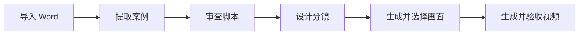

# AI 科普动画生产工作台

### AI Explainer Video Studio

把一份已经审定的 Word 科普脚本，逐步整理成可审查的案例、分镜、画面提示词和动画视频候选。程序负责保存事实、维护状态和处理重复工作，AI 提供生成建议，最终采用什么内容始终由人决定。

## 项目背景

一条科普动画并不是输入一句 Prompt 就能完成。正式脚本需要先拆出独立案例，再核对人物和对白，设计分镜，生成画面，最后把图片、动作和台词组织成视频。原来的制作过程分散在 Word、生成工具和本地文件之间，修改一个镜头以后，很难马上判断哪些画面和视频需要重新处理。

这个工作台把这些步骤放进同一个项目里。原文、人工修改和 AI 建议分别保存，每个阶段都有明确的确认状态。用户可以随时知道当前结果来自哪里、是否已经采用，以及上游改变后哪些成果已经不再适用。

## 从脚本到动画



导入后，程序先按确定性规则保留段落和原文，再由用户检查案例边界与脚本问题。确认后的内容进入分镜阶段，每个镜头独立记录人物、动作、场景、对白和时长。画面与视频阶段会保存每次生成使用的提示词、参考素材、账号、候选结果和人工决定。

外部模型或网页生成失败时，任务不会直接覆盖已经采用的内容。系统保留失败原因和现场状态，让用户选择重试、回填结果或回到上一步调整。

## 修改以后会发生什么

制作过程中最容易出错的地方不是第一次生成，而是后续修改。例如一个镜头的时长改变后，本镜视频需要重新核对；如果下一镜沿用了它的尾帧或人物状态，下一镜也应回到待确认状态。如果下一镜是独立开场，没有引用关系，它就不应该被一起清空。

工作台因此使用明确的依赖关系处理修改：只让真正受到影响的结果失效，同时保留仍然有效的人工成果。这套规则被分镜编辑、画面采用、尾帧更新和提示词重写等入口共同使用，避免不同页面各自维护一套判断。

## 人与 AI 如何分工

- **程序负责确定性工作**：保存原文、检查格式、管理版本、维护依赖和任务状态。
- **AI 负责提出候选**：辅助复核脚本、整理分镜建议、润色提示词并诊断被退回的图片。
- **用户负责业务决定**：确认脚本与分镜、选择参考图、判断视频是否通过，并决定哪些经验可以继续复用。

这种分工牺牲了一部分“一键完成”的速度，但保留了科普内容需要的事实准确性、修改空间和责任边界。

## 我的工作

我既是这个流程的实际使用者，也是产品负责人。我负责还原制作过程、划分六个阶段、设计状态与依赖关系、确定模型和人工的边界，并制定失败恢复、隐私隔离和验收规则。Claude 与 Codex 参与代码实现、测试和审查；产品取舍、优先级和最终验收由我负责。

## 当前进展

公开版本已经完成本地六阶段主流程，并通过以下检查：

- 网页工作台的 lint、TypeScript、生产构建和 16 套核心逻辑回归。
- 本机媒体 Provider 的 79 条自动化测试。
- Word 提取器的 6 条 Python 回归测试。
- 在全新目录中重新安装依赖、构建、启动并完成 HTTP 冒烟检查。

这些结果说明主要规则和启动链路可以重复执行，还不能证明产品已经节省了多少时间。下一步需要让一名不了解实现细节的使用者独立完成整条任务，并记录首次成功时间、返工次数、生成成功率和人工修改比例。真实模型的长期稳定性与连续镜头体验也仍需继续验证。

## 进一步了解

- [产品需求文档](PRD.md)：完整的目标、范围、流程和验收要求。
- [当前版本说明](PROJECT.md)：已经实现的规则、验证记录和当前限制。
- [视觉与交互规则](STYLE_GUIDE.md)
- [开发与回归说明](DEVELOPMENT.md)
- [公开同步范围](SYNC-CONTENTS.md)

<details>
<summary><strong>本机安装与运行</strong></summary>

准备支持 `--experimental-strip-types` 的 Node.js、npm 和 Python 3，在仓库根目录的 PowerShell 中执行：

```powershell
python -m pip install -r AI视频agent/requirements.txt
npm.cmd --prefix publicity-video-ai-workbench ci
npm.cmd --prefix doubao-native-provider ci
scripts\start-all.cmd
```

默认网页地址为 `http://localhost:3001/`。首次进入时注册本地工作台账号，在设置中配置模型连接，再由用户登录自己的豆包账号。示例配置位于 `publicity-video-ai-workbench/env.local.example`，不包含密钥。

完整校验：

```powershell
Push-Location publicity-video-ai-workbench
npx.cmd next typegen
npm.cmd run verify
Pop-Location
npm.cmd --prefix doubao-native-provider test
python -B AI视频agent/scripts/test_extract_story_sections.py
```

</details>

## 数据与隐私

发布仓库只包含源码、测试、文档和脱敏演示素材。真实用户数据、生产项目、生成媒体、账号、API 密钥、豆包会话、本机日志和私人 Git 历史均不在仓库中。

为兼容已有安装，本机媒体数据仍使用历史目录名 `%LOCALAPPDATA%/AI科普视频制作台/`。这个目录名只是存储兼容路径，不代表当前产品名称。同一 Windows 账号下的两个源码副本会共享该目录和默认服务端口。
